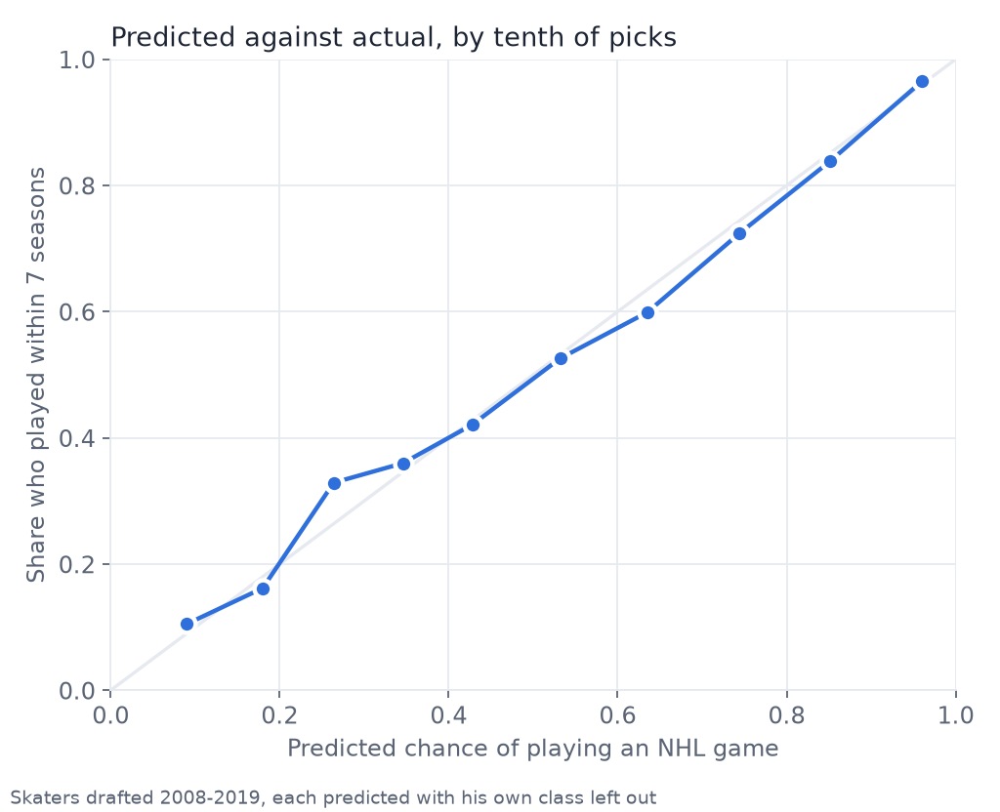
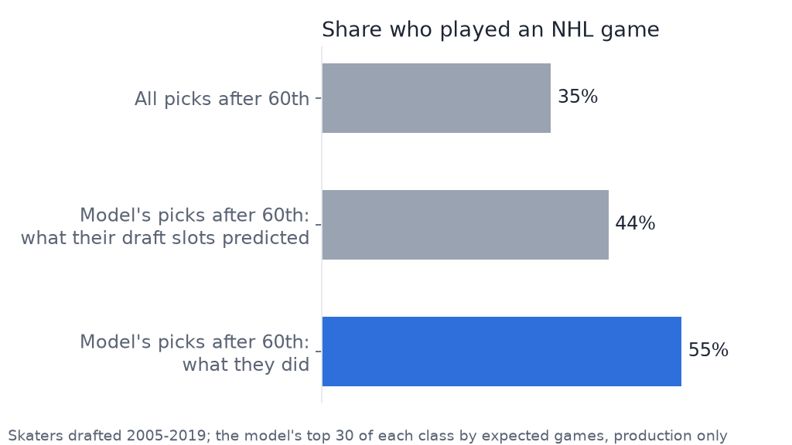

# Expected Success Model (2026)

An updated and improved version of my 2021 Master of Statistics research project,
*Overdispersion in Count Modelling with an NHL Draft Application: Measuring Player
Success* (University of Western Ontario, supervised by Dr. Douglas Woolford; the full
report is in the root of this repository).

The question is the same: of the players drafted each year, which ones will go on to
NHL careers? About half of all picks never play a single NHL game, so the outcome is a
count with a huge spike at zero, and the 2021 report showed that a hurdle model handles
that best. This version keeps the hurdle idea and rebuilds everything around it: new
data straight from the NHL, a count model that respects the schedule, only information
a team has on draft day, and testing on draft classes the model has never seen.

## What changed since 2021

| | 2021 report | 2026 model |
|---|---|---|
| Data | Schulte, Liu & Li (2018), scraped from Hockey-Reference: 2,224 picks | The NHL's own public API: every pick from 2005 to 2019 (3,194 picks, 3,192 matched to their NHL records), plus the 2020 to 2026 classes for projections |
| Outcome | NHL games in the first seven seasons after the draft | The same, for every class fully observed |
| Predictors | Included draft position (`Overall`) | Only what is known before the draft. Draft position is kept as the benchmark to beat, never as an input |
| Production | Draft-year totals, treated the same in every league | Points a game in the draft season, with each league group getting its own value for a point (a point in the SHL is not a point in the USHL), plus the change over the two seasons before, draft-season playoffs, U18 and U20 international events, plus-minus and even-strength goals where the league reports them |
| Count part | Zero-truncated negative binomial | Zero-truncated beta-binomial: games out of the games on the schedule, so no projection can pass what was possible (the 2013 lockout and both shortened COVID seasons included) |
| Testing | In-sample (AIC, rootograms) | Leave-one-class-out: every pick is predicted by a model fitted without his draft class |
| Goalies | Pooled with skaters | Fitted separately, and left out of the results (too little signal, see below) |
| Central Scouting | Included | Tested both ways: production only, and production plus NHL Central Scouting's final rank (published before each draft, available from 2008) |

## Why seven seasons, not a whole career

The outcome is NHL games in the first seven seasons after the draft, as in the 2021 report.
Careers are still going for most players drafted since 2010, so career games are not known
yet (Matthews is past 700 and counting). Counting a fixed seven seasons means every class up
to 2019 is complete and comparable, and the model can be checked against what actually
happened. It also makes the ceiling exact: in Matthews' first seven seasons (2016-17 to
2022-23) Toronto played 537 games, so no projection for him in that window can be higher.
A projection of career games is a separate model (careers still in progress need survival
methods) and a natural next step.

## The model

Two parts, fitted by maximum likelihood with a ridge penalty chosen by leaving classes out:

1. **The hurdle.** A logistic regression for the chance a pick plays at least one NHL game
   within seven seasons.
2. **The count.** For those who clear it, a zero-truncated beta-binomial for how many games
   they play out of the games on the schedule in their seven seasons (537 to 574 depending
   on the class).

**Expected success** = chance to play × expected games if he plays.

Inputs (skaters): age on September 15 of his draft year, height, weight, position,
country, his league group in the draft season (OHL, WHL, QMJHL, USHL, US National Team
Development Program, NCAA, European pro, European second tier, European junior, Junior A,
US high school), his points a game there with a separate slope for each league group,
goals a game, penalty minutes a game, games played, the change in points a game from the
season before and two seasons before, and the interaction of age with production. The
published version adds Central Scouting's final rank (North American and international lists
apart) and the rest of what the NHL's records hold from before the draft: playoff points a
game in the draft season, games and points at U18 and U20 international events (the U18
Worlds, the Hlinka Gretzky Cup, the World Juniors) in the draft season or the one before,
plus-minus a game, and even-strength goals a game where the league reports power-play goals.

## How well it works

All numbers are out of sample: each draft class predicted by a model that never saw it.

| Skaters drafted 2008 to 2019 (2,276) | Separating players from non-players (AUC) | Ranking each class by career games (Spearman, mean over classes) |
|---|---|---|
| The actual draft order | 0.784 | 0.570 |
| Model, production only | 0.775 | 0.536 |
| Model, production + Central Scouting | 0.805 | 0.591 |
| **Model, production + Central Scouting + playoffs, international events, plus-minus** | **0.807** | **0.597** |
| Draft order and the published model together | 0.823 | |

- With Central Scouting's ranks, the model **beats the order teams actually drafted in**,
  and the published version ranked 10 of the 12 classes closer to how careers turned out.
- From box-score production alone it nearly matches the draft (0.775 against 0.784), and
  it still adds information the draft order does not have: the two together reach 0.823.
- It is well calibrated: split into ten groups by predicted chance, the predicted share and
  the share who actually played are within 4 points in nine of the ten (the tenth: 26%
  predicted, 33% played).



**Finding players the draft missed.** Taking the production-only model's top 30 of each
class (no scouting input at all), the ones drafted after 60th played an NHL game 55% of
the time, against the 44% their draft slots predicted and 35% for all late picks.



## Fixing the count model

The 2021 report's best fit used a zero-truncated negative binomial. Its mean is
exp(linear predictor) with nothing to stop it, and on the full data that shows: refitted
here, it projected **1,238 games** in his first seven seasons for Auston Matthews (2016),
when his club played 537 games in those seasons (two were shortened by COVID). He played 481.

Modelling games as a share of the schedule (beta-binomial) fixes the ceiling and fits
better everywhere (both fitted with the same inputs, production + Central Scouting):

| Count part, out of sample | Typical error (log scale) | Largest projection | Players projected 300+: projected / actual |
|---|---|---|---|
| Zero-truncated negative binomial (2021) | 1.092 | 1,238 games | 425 / 377 |
| **Zero-truncated beta-binomial (2026)** | **1.075** | **482 games** | **366 / 382** |

In the published model Matthews projects at 460 games (481 played) and Connor McDavid at
442 (487).

## What the model learned

- **Being on Central Scouting's final list** is the strongest single signal, then the rank
  on it.
- **Production at a younger age is worth more.** The same points a game at 18 counts for
  more than at 19 (the age × production term).
- **Playmakers do better than pure scorers.** Holding points fixed, a larger share of goals
  lowers a pick's chances. The 2021 report found assists were the statistic that mattered
  most; this version finds the same thing a different way.
- **Heavier for his height helps; height alone does not.** Also a 2021 finding, now
  confirmed on new data.
- **NCAA and European pro players** start ahead of junior players with the same numbers:
  playing against adults at 18 is itself a signal.
- **Playoffs and national teams count.** Scoring in the draft-season playoffs and making a
  national team at U18 or U20 each raise a pick's chances beyond his regular season.
- **Goalies are hard.** Their model separated players from non-players at 0.62 against the
  draft order's 0.70, so goalie projections are left out.

## The 2026 draft class

Projections for the most recent class, from its draft-season numbers and Central
Scouting's 2026 lists. These are the model's view on draft day; development since will
change them.

| Pick | Player | Team | Draft-season league | Chance to play | Expected games (7 seasons) |
|---|---|---|---|---|---|
| 2 | Ivar Stenberg | SJS | SHL | 98% | 406 |
| 1 | Gavin McKenna | TOR | NCAA | >99% | 391 |
| 6 | Carson Carels | CGY | WHL | 99% | 343 |
| 7 | Chase Reid | SEA | OHL | 97% | 324 |
| 15 | Nikita Klepov | ANA | OHL | 97% | 311 |
| 9 | Keaton Verhoeff | SJS | NCAA | 99% | 310 |
| 4 | Daxon Rudolph | BUF | WHL | 98% | 286 |
| 5 | Alberts Smits | NYR | Liiga | 96% | 278 |
| 3 | Caleb Malhotra | VAN | OHL | 96% | 267 |
| 17 | Ethan Belchetz | UTA | OHL | 97% | 242 |

Late picks it likes most: Tomas Chrenko (81st, NYR), Tomas Kralovic (90th, TBL), Adam
Valentini (96th, UTA), Blake Zielinski (80th, LAK) and Ola Palme (166th, SEA). Every
skater from 2020 to 2026 is in `results/projections_2020_2026.csv`.

## Data looked at and not used

- **NHL Combine testing:** only the top 25 in each test are published, so it cannot be used
  for every prospect.
- **Elite Prospects:** the richest prospect database, but a paid licence.
- **League sites (CHL, USHL and others):** finer stats such as shots and even-strength
  points for every league, but they need a terms-of-use review before automated collection.
- **Scouting reports and articles:** copyrighted text.

## Limitations

- **NHL games are the yardstick.** A European pick who builds a career at home counts as a
  miss. Most of the late picks the model liked most who never played were Swedes and Czechs
  who stayed in Europe.
- **Only drafted players.** Undrafted signings are outside the data.
- **Box-score production only.** No skating, no tracking, no video, and no team context
  (linemates, ice time, power play).
- **Central Scouting is consensus.** The production-only model shows how far the numbers go
  on their own.
- **Recent classes are not finished.** Players drafted after 2019 have not had their seven
  seasons yet, so their projections cannot be checked.

## Reproduce

```bash
pip install -r requirements.txt
python fetch.py cache 2005 2026      # NHL draft picks, player records, Central Scouting lists (cached)
python model.py cache results        # fit, out-of-sample test, projections
python figures.py results            # the two charts
```

| File | What it does |
|---|---|
| `fetch.py` | Every pick from the NHL's draft feed, matched to his NHL player record by the NHL's player search and confirmed by his recorded draft year and pick, so nobody is matched on name alone. Also Central Scouting's lists |
| `data.py` | One row per pick: the outcome, the games possible, and every pre-draft input |
| `model.py` | The hurdle model (logistic gate, zero-truncated beta-binomial count), the leave-one-class-out test, the comparison with the 2021 count model, and the projections |
| `figures.py` | The charts above |
| `results/` | `report.json` (every number above), the charts, and the 2020 to 2026 projections |

Data: NHL public API (api-web.nhle.com), fetched November 2026.
